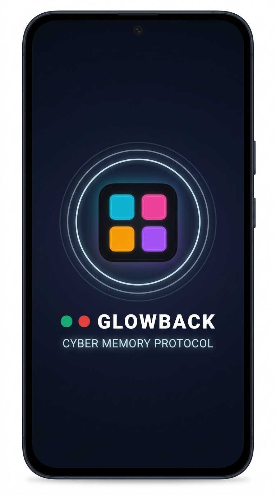
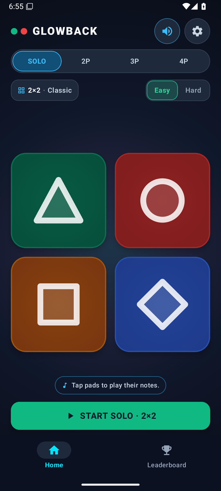
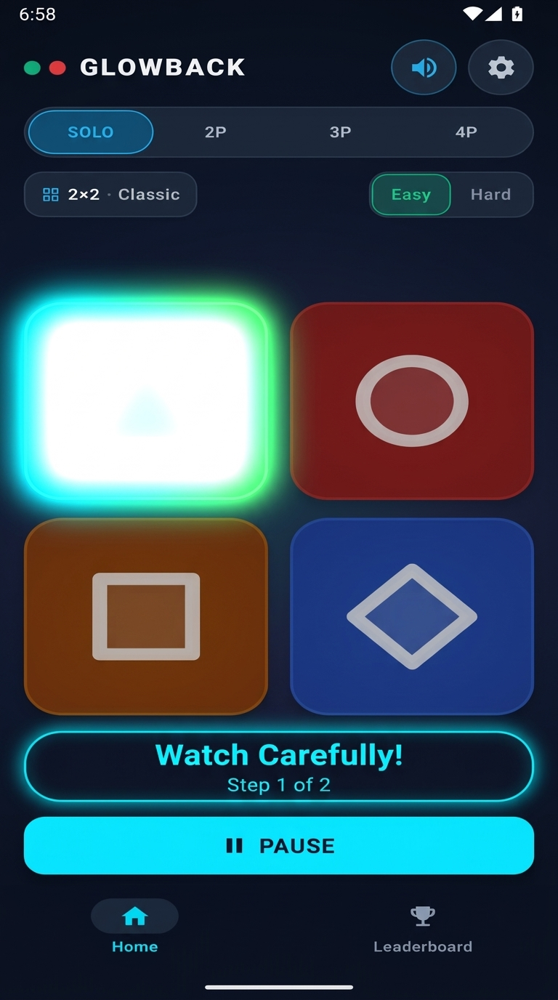
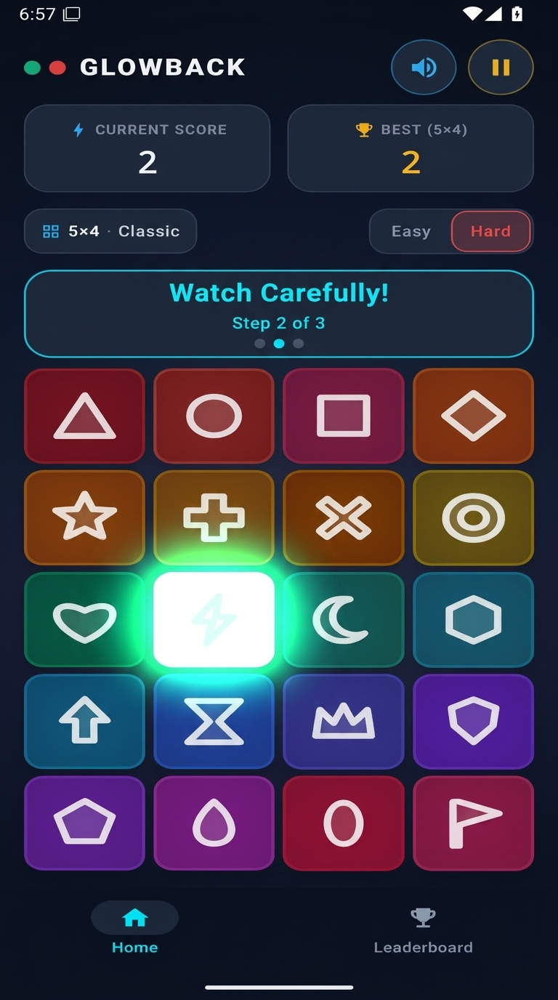
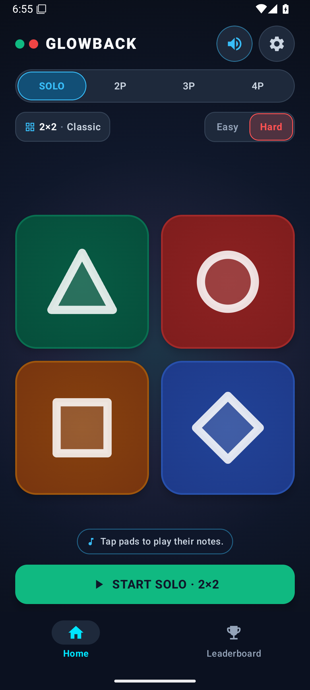
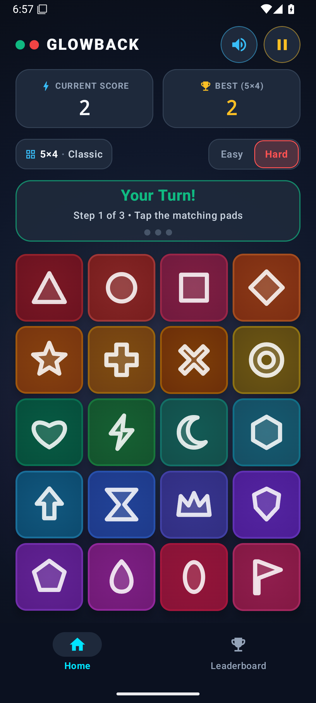

# Glowback Visual Showcase (All 6 Screens)

Here are the 6 authentic images created directly from your real Glowback app screenshots, complete with the active mid-flash effects, in-game banners, and HUD states:

---

### 1. App Icon / Splash Screen (0–2s Intro)
*Sleek midnight obsidian backdrop with glowing 4-pad emblem and brand title.*

---

### 2. Home Idle (2×2 Grid, Easy Selected)
*Original authentic home state with glowing mode pills, clean geometry, and Start Solo action.*

---

### 3. Mid-flash Moment (2×2 "Watch Carefully!")
*Top-left Triangle pad bursting into pure white flash (`#FFFFFF`) with neon bloom under the active sequence playback banner.*

---

### 4. 5×4 Grid Mid-flash (Big-board scale)
*Massive 20-pad board with live score HUD, cyan "Watch Carefully! Step 2 of 3" banner, and the Lightning Bolt pad flashing brilliant electric white.*

---

### 5. Hard Mode (Hard Toggle in Red)
*Original authentic 2×2 board with the Hard mode toggle activated in glowing crimson red (`#FF1744`).*

---

### 6. "Your Turn!" State (With Progress Dots)
*Original authentic 5×4 board showing the green "Your Turn! Step 1 of 3" status banner with step dots ready for player input.*

